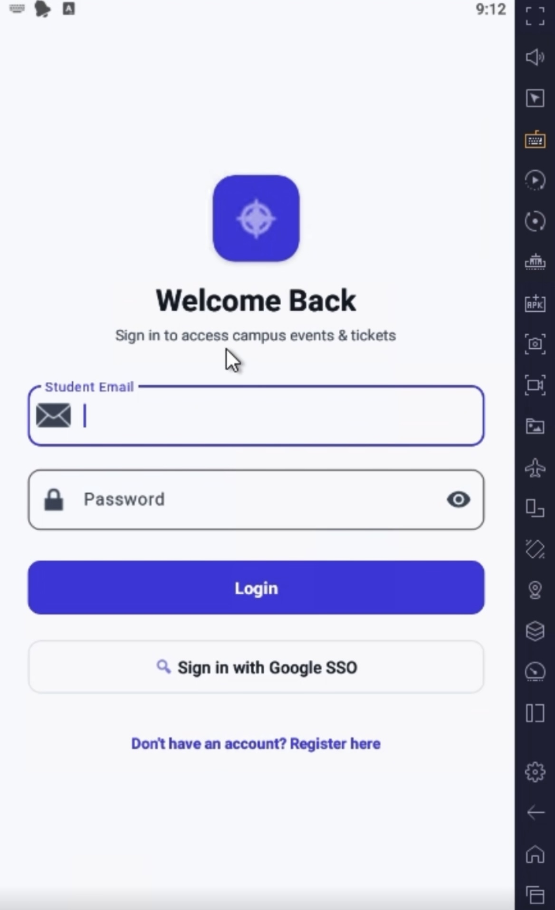
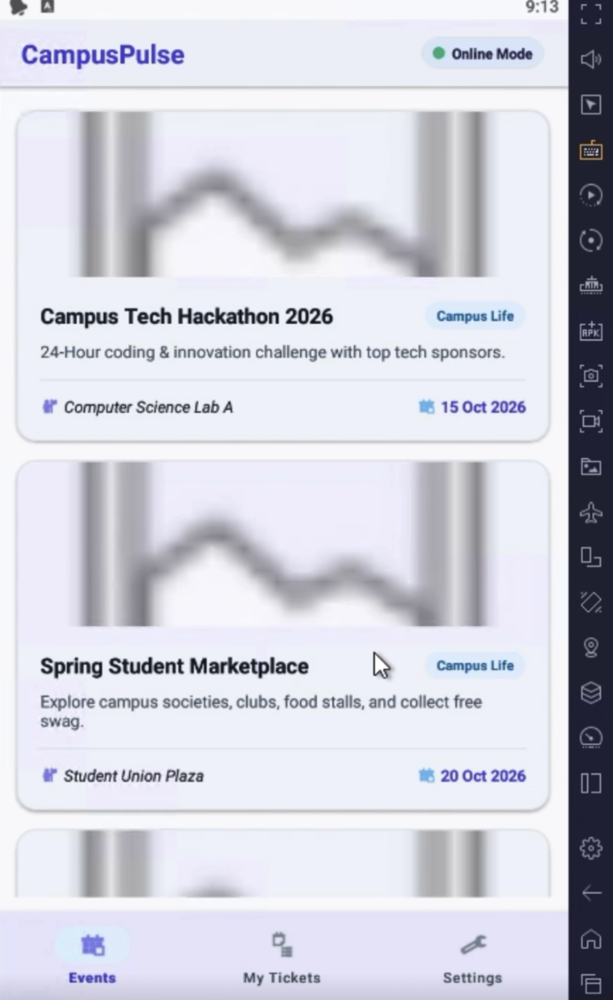
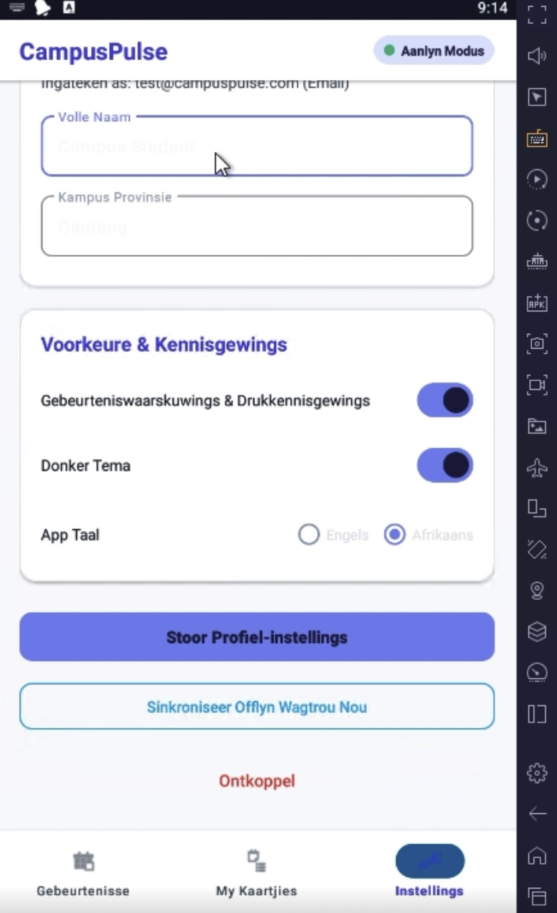
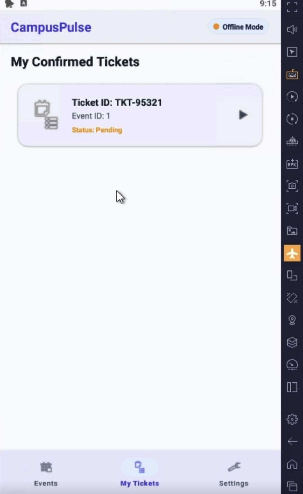
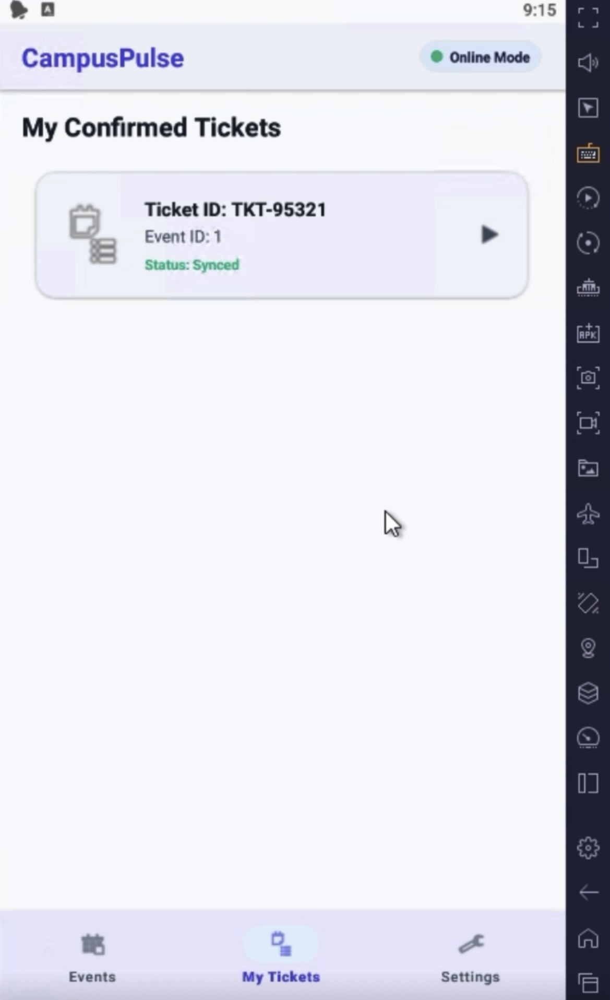

\# CampusPulse 📱


\[!\[Android CI/CD](https://github.com/DugStellar/OPSC6312-PART3-FINAL-POE-CampusPulse/actions/workflows/android.yml/badge.svg)](https://github.com/DugStellar/OPSC6312-PART3-FINAL-POE-CampusPulse/actions)


CampusPulse is a modern, native Android application built using Kotlin and Material Design 3. It serves as a central platform for students to browse campus events, manage tickets, and stay updated with real-time notifications, featuring full offline data synchronization and dynamic multi-language localization.


\---
## 📱 App Screenshots

| Login / Home | Event List | Afrikaans Toggle | Ticket Management (Offline) | Ticket Management (Online) |
| :---: | :---: | :---: | :---: | :---: |
|  |  |  |  |  |


\## 📹 Video Presentation

\- \*\*YouTube Walkthrough Link\*\*: https://youtube.com/shorts/DSVFj19mFP8


\---


\## ✨ Key Features

\- \*\*Secure Authentication\*\*: User registration and login utilizing SHA-256 client-side password hashing.

\- \*\*REST API Integration\*\*: Real-time event and ticket data fetching via Retrofit and OKHttp interceptors.

\- \*\*Offline Caching \& Persistence\*\*: Persistent local storage powered by Room Database.

\- \*\*Background Synchronization\*\*: Background sync handled by Android WorkManager when connectivity restores.

\- \*\*Dynamic Localization\*\*: Real-time language switching between \*\*English\*\* and \*\*Afrikaans\*\* without restarting the application.

\- \*\*Material Design 3 Theme\*\*: Dynamic Dark and Light mode toggling in app settings.


\---


\## 🛠️ Architecture \& Tech Stack

\- \*\*Language\*\*: Kotlin

\- \*\*UI Framework\*\*: Material Design 3 / Jetpack Components

\- \*\*Local Database\*\*: Room (SQLite)

\- \*\*Networking\*\*: Retrofit 2 + Gson Converter

\- \*\*Background Tasks\*\*: WorkManager

\- \*\*Build Tool\*\*: Gradle (Kotlin DSL)


\---


\## 🚀 Getting Started \& Build Instructions


\### Prerequisites

\- Android Studio Ladybug or newer

\- JDK 17

\- Android SDK 34 (Android 14)


\### Building from Source

1\. Clone the repository:

&#x20;  ```bash

&#x20;  git clone \[https://github.com/DugStellar/OPSC6312-PART3-FINAL-POE-CampusPulse.git](https://github.com/DugStellar/OPSC6312-PART3-FINAL-POE-CampusPulse.git)

AI Tools Usage Statement

During the development of CampusPulse, AI tools were used purely as a supportive coding assistant and debugging aid. All core app architecture, UI design, database logic, and final implementation remained entirely student-led.

AI was selectively used for:

Debugging & Build Support: Troubleshooting Gradle configuration issues and resolving Kotlin state management errors.

Localization Assistance: Verifying accurate dynamic string translations for the Afrikaans language toggle.

Documentation Formatting: Structuring clean Markdown tables in the README.md to showcase app screenshots side-by-side.

All suggestions and code snippets provided by AI were manually reviewed, refactored, and thoroughly tested within Android Studio to ensure complete project ownership and compliance.

